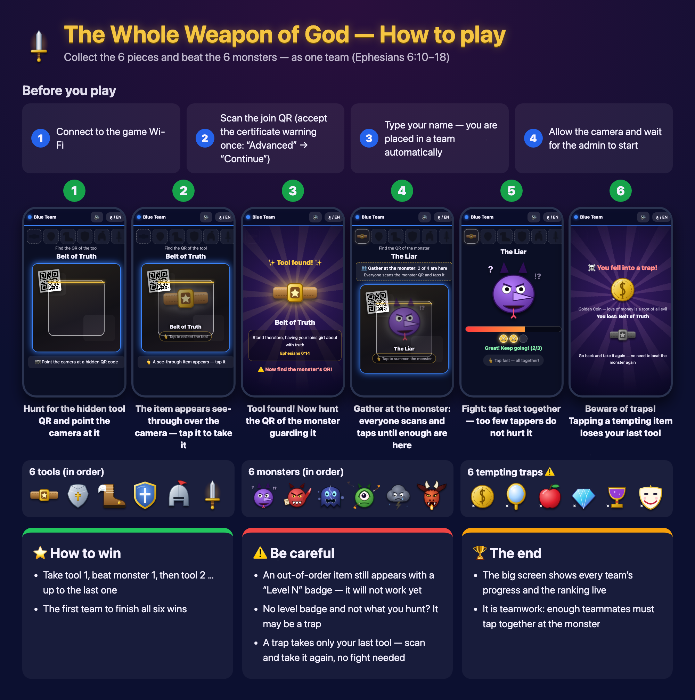
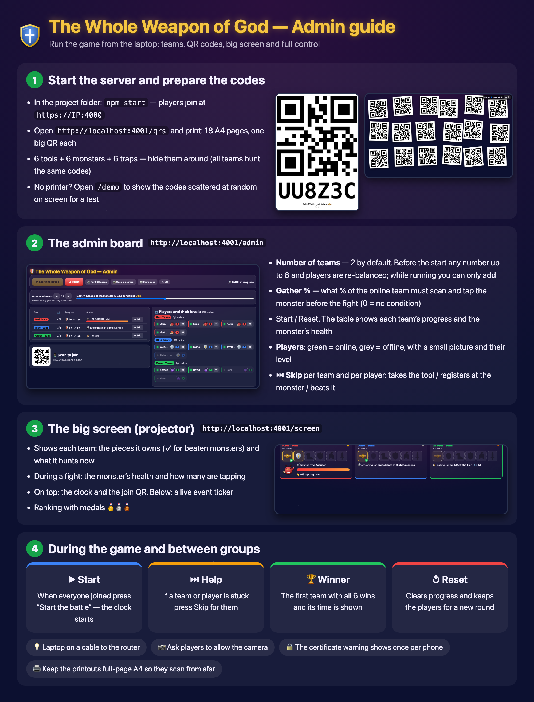

# The Whole Armor of God (سلاح الله الكامل)

A team treasure-hunt and monster-battle game for phones on a local Wi-Fi network (Ephesians 6:10-18), built with Node.js, Express and Socket.IO. Teams hunt for hidden QR codes to collect the six pieces of the armor, then fight six monsters by tapping together. The interface is bilingual (Arabic / English). No internet connection is needed once installed.

## What you need

| Item | Details |
|---|---|
| Node.js | 18 or newer (developed on Node 24) |
| A laptop | Runs the server, the admin panel and the projector screen |
| Players' phones | Modern browser with a camera; 2 to 8 teams, ideally 3+ players per team (later monsters need up to 6 teammates tapping at once, capped by team size) |
| Network | One Wi-Fi network shared by the laptop and all phones (laptop on a cable to the router is best) |
| Printer (optional) | 18 A4 pages. Without one use the on-screen `/demo` page |
| Chrome (optional) | Only to rebuild the guide images with `guide/build.sh` |

No accounts, API keys or external services are used.

## Install and run

```bash
npm install
npm start        # HTTPS on port 4000
npm test         # plays a full game with bots
```

Environment variables: `PORT` (default `4000`), `TEAMS` (starting number of teams, default 2), `GATHER_PERCENT` (default 50), `HTTP_ONLY=1` (plain HTTP for tests only; phone cameras need HTTPS).

On first start the server generates `data/cert.json` (self-signed certificate) and `data/secret.txt` (source of the QR codes). Both are git-ignored; keep `data/secret.txt` once you have printed the cards. Each browser shows a certificate warning the first time: press **Advanced**, then **continue**.

## How to run an event

1. Open `https://localhost:4000/qrs` on the laptop and print 18 pages (one big QR each: 6 tools, 6 monsters, 6 trap decoys, shared by all teams). Hide them around the venue. Quick preview without printing: `https://localhost:4000/demo` scatters the QRs on the projector and reshuffles them every 15 s.
2. Project `https://localhost:4000/screen`. Players scan its join QR, accept the certificate warning and type a name.
3. Open `https://localhost:4000/admin`. Choose the number of teams (up to 8; in the lobby players are re-balanced, while running you can only add teams) and the **gather %**, then press **Start**.

Admin pages (`/admin`, `/qrs`, `/demo`) only work on the laptop running the server.

## How to play

- Scan a QR with the in-page camera: the item appears see-through over the camera. **Tap it** to collect the tool or summon the monster.
- Collect the tools in order. A tool unlocks after the previous monster is beaten. Out-of-order items show a "Level N" badge and a message.
- A monster appears once its tool is owned and the **gather condition** is met: at least the admin's % of the online team must have scanned the monster's QR and tapped it within 45 s (0% disables the condition). Then teammates tap together to defeat it.
- **Traps** (coin, mirror, apple, gem, chalice, mask) look tempting: tapping one makes the team lose its last tool. Scan and tap it again to get it back.
- The first team to collect all 6 pieces and beat all 6 monsters wins.

## Configuration

`config.js` holds team colors, the tools and verses, monsters (health, how many teammates must tap together), traps and location `hint`s. Restart after editing.

## Guides

How-to-play images for players and admins, in Arabic and English (rebuild with `guide/build.sh`):




Also see `guide/armor-of-god-player-ar.png`, `guide/armor-of-god-admin-ar.png` and the posters in `guide/poster/`.

## Animated monsters

Monsters 2 and 6 use a single picture bent in the browser (mesh warp in `public/mwarp.js`); bones are defined in `RIGS` inside that file, and `?mwt=<ms>` freezes time for screenshots. The monsters were cut from AI-generated parts sheets (`guide/monsters/src`); `guide/monsters/tools/segment.py` and `build_rigs.py` (Python) rebuild `public/monsters/`. Preview: `/monsters-preview.html`.

## Project structure

```
server.js   Express + Socket.IO server, HTTPS, admin routes
game.js     Game rules and state
share.js    LAN addresses and QR generation
config.js   Teams, tools, monsters, traps
public/     Web pages (player, screen, admin, QR sheets) and monster art
guide/      Guide images, posters, monster sources and build tools
test/       smoke.js (full bot game)
data/       Generated at runtime (git-ignored)
```

License: MIT
